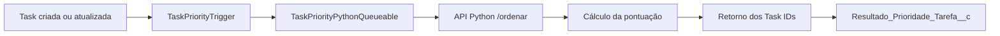

# Ordenação Automática de Tarefas por Prioridade

Projeto de portfólio que integra Salesforce, Apex e Python para recomendar automaticamente a ordem de execução de tarefas pendentes.

> **Salesforce é o quadro de tarefas. Python só sugere a ordem.**

## Visão geral

Usuários que trabalham com várias tarefas precisam decidir manualmente qual atividade deve ser executada primeiro. Esse processo pode causar atrasos e falta de padronização.

Este projeto automatiza essa recomendação:

1. Uma tarefa é criada ou atualizada no Salesforce.
2. Um Trigger Apex identifica a alteração.
3. Um Queueable Apex inicia o processamento assíncrono.
4. O Salesforce envia as tarefas pendentes para uma API Python.
5. A API calcula a pontuação e retorna somente os IDs ordenados.
6. O Salesforce grava a pontuação e a ordem recomendada.

## Arquitetura



## Fluxo técnico

```text
Salesforce Task
      |
      v
TaskPriorityTrigger
      |
      v
Queueable Apex
      |
      | HTTP POST
      v
API Python
      |
      | task_ids ordenados
      v
Salesforce
      |
      v
Resultado_Prioridade_Tarefa__c
```

## Tecnologias

- Salesforce;
- Apex;
- SOQL;
- Salesforce CLI;
- Queueable Apex;
- Apex Trigger;
- API REST;
- Python;
- FastAPI;
- HTTP/JSON;
- Git;
- PowerShell.

## Componentes Salesforce

### `TaskPriorityTrigger`

Executado após:

- inserção de uma tarefa;
- atualização de uma tarefa.

A responsabilidade do Trigger é iniciar o processamento assíncrono sem realizar o callout diretamente.

### `TaskPriorityPythonQueueable`

Responsável por:

- consultar tarefas abertas;
- preparar os dados da integração;
- realizar a chamada HTTP para a API Python;
- receber a sequência recomendada de IDs;
- limpar resultados anteriores;
- calcular ou registrar a pontuação;
- gravar os resultados no Salesforce.

O uso de Queueable Apex evita a realização de callouts diretamente no contexto do Trigger.

### `Resultado_Prioridade_Tarefa__c`

Objeto utilizado para armazenar o resultado do processamento.

Campos principais:

| Campo | Finalidade |
|---|---|
| `Task_Id__c` | ID da tarefa processada |
| `Pontuacao__c` | Pontuação calculada |
| `Ordem_Recomendada__c` | Posição recomendada da tarefa |
| `Data_Processamento__c` | Data e hora do processamento |

## API Python

A API recebe as tarefas abertas em formato JSON e retorna somente a sequência dos IDs.

### Requisição

```json
{
  "tasks": [
    {
      "id": "00TgL00000EVoy9UAD",
      "status": "Not Started",
      "due_date": "2026-10-06",
      "priority": "Normal",
      "customer_value": 0,
      "task_type": "Teste prioridade normal para hoje",
      "urgency": 0
    }
  ]
}
```

### Resposta

```json
{
  "task_ids": [
    "00TgL00000EVoy9UAD"
  ]
}
```

A API não cria, atualiza ou exclui tarefas no Salesforce. Ela apenas calcula e retorna a recomendação.

## Critérios de priorização

A pontuação atual considera principalmente:

- prazo da tarefa;
- tarefas atrasadas;
- tarefas para o dia atual;
- prioridade Salesforce;
- situação da tarefa.

Tarefas concluídas não participam da ordenação.

A arquitetura permite adicionar futuramente:

- valor do cliente;
- tipo da tarefa;
- urgência;
- quantidade de tarefas pendentes por usuário;
- regras específicas de negócio.

## Teste validado

Foi realizado um teste com duas tarefas pendentes:

| Ordem | Task ID | Situação | Pontuação |
|---:|---|---|---:|
| 1 | `00TgL00000EVtmYUAT` | Atrasada e prioridade High | 70 |
| 2 | `00TgL00000EVoy9UAD` | Para hoje e prioridade Normal | 45 |

Resultado persistido no Salesforce:

```text
Task 00TgL00000EVtmYUAT
Pontuação: 70
Ordem recomendada: 1

Task 00TgL00000EVoy9UAD
Pontuação: 45
Ordem recomendada: 2
```

Esse teste confirmou que uma tarefa atrasada com prioridade alta é colocada antes de uma tarefa normal para o dia atual.

## Validação da execução assíncrona

O processamento foi executado por Queueable Apex com sucesso:

```text
Status: Completed
Erros: 0
```

Fluxo validado:

```text
Task criada
  -> Trigger acionado
  -> Queueable enfileirado
  -> API Python chamada
  -> IDs ordenados retornados
  -> Resultados gravados no Salesforce
```

## Estrutura do projeto

```text
ordenacao-tarefas-prioridade/
├── docs/
├── python/
│   └── inference.py
├── salesforce/
│   ├── force-app/
│   │   └── main/
│   │       └── default/
│   │           ├── classes/
│   │           ├── objects/
│   │           ├── remoteSiteSettings/
│   │           └── triggers/
│   └── sfdx-project.json
├── .gitignore
└── README.md
```

## Execução local

### API Python

A API está localizada no diretório `python`.

Entre na pasta:

```powershell
cd ..\python
```

Ative o ambiente virtual:

```powershell
.\.venv\Scripts\Activate.ps1
```

Execute a API conforme a configuração do arquivo `inference.py`.

### Salesforce

Entre na pasta do projeto Salesforce:

```powershell
cd ..\salesforce
```

Consulte os jobs do Queueable:

```powershell
sf data query --target-org estudo --query "SELECT Id, ApexClass.Name, Status, NumberOfErrors, CreatedDate, CompletedDate FROM AsyncApexJob WHERE ApexClass.Name = 'TaskPriorityPythonQueueable' ORDER BY CreatedDate DESC LIMIT 5" --result-format human
```

Consulte os resultados calculados:

```powershell
sf data query --target-org estudo --query "SELECT Id, Task_Id__c, Pontuacao__c, Ordem_Recomendada__c, Data_Processamento__c FROM Resultado_Prioridade_Tarefa__c ORDER BY Ordem_Recomendada__c ASC" --result-format human
```

## Decisões de arquitetura

### Salesforce como sistema principal

O Salesforce continua responsável por:

- armazenar as tarefas;
- controlar o status;
- iniciar o processamento;
- armazenar os resultados.

### Python como serviço de recomendação

O Python é responsável somente por:

- receber os dados;
- aplicar as regras de priorização;
- devolver a sequência de IDs.

Essa separação reduz o acoplamento entre o cálculo e o sistema de origem.

### Processamento assíncrono

O uso de Queueable Apex permite que o Trigger permaneça leve e que a chamada externa seja realizada em um contexto apropriado para callouts.

### Resultados separados das tarefas

A recomendação é armazenada no objeto `Resultado_Prioridade_Tarefa__c`, sem alterar diretamente os registros originais de `Task`.

## Segurança e produção

Durante o desenvolvimento, a API foi disponibilizada temporariamente para permitir a comunicação com o Salesforce.

Para um ambiente de produção, recomenda-se:

- hospedar a API em uma URL estável;
- utilizar HTTPS permanente;
- adicionar autenticação por token;
- armazenar segredos em variáveis de ambiente;
- configurar monitoramento;
- registrar erros e tentativas de integração;
- implementar timeout e política de retry;
- evitar exposição de dados sensíveis.

## Próximas melhorias

- adicionar autenticação na API;
- criar testes automatizados para o endpoint `/ordenar`;
- ampliar os critérios de pontuação;
- adicionar logs estruturados;
- implementar retry para falhas temporárias;
- criar uma interface para visualizar a ordem recomendada;
- adicionar pipeline de testes no GitHub Actions;
- disponibilizar a API em ambiente de hospedagem estável;
- criar documentação OpenAPI detalhada.

## Competências demonstradas

Este projeto demonstra conhecimentos em:

- desenvolvimento Salesforce;
- Apex;
- Triggers;
- Queueable Apex;
- SOQL;
- processamento assíncrono;
- integração REST;
- Python;
- FastAPI;
- comunicação HTTP;
- JSON;
- arquitetura distribuída;
- tratamento das responsabilidades entre os sistemas;
- Git;
- documentação técnica.

## Autor

**Rafael Alexandre Oliveira Araújo**

Projeto desenvolvido para demonstrar integração entre Salesforce, Apex e Python aplicada a um problema real de priorização de tarefas.

LinkedIn: https://linkedin.com/in/seu-perfil
GitHub: https://github.com/Rafaelaale
